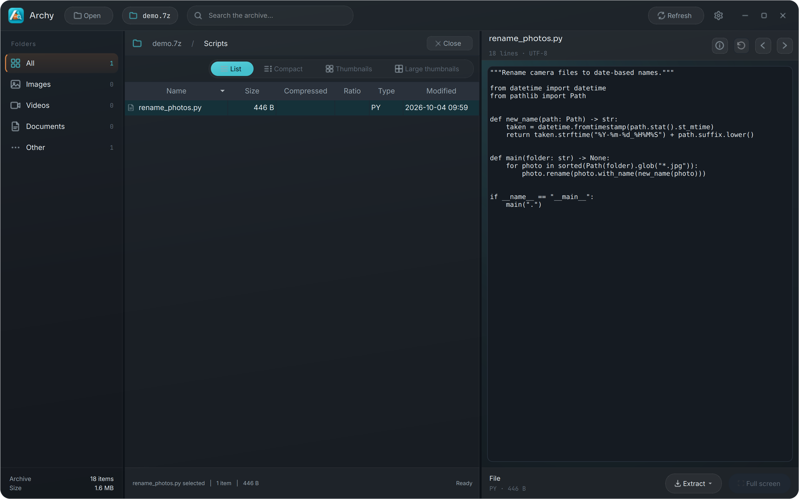
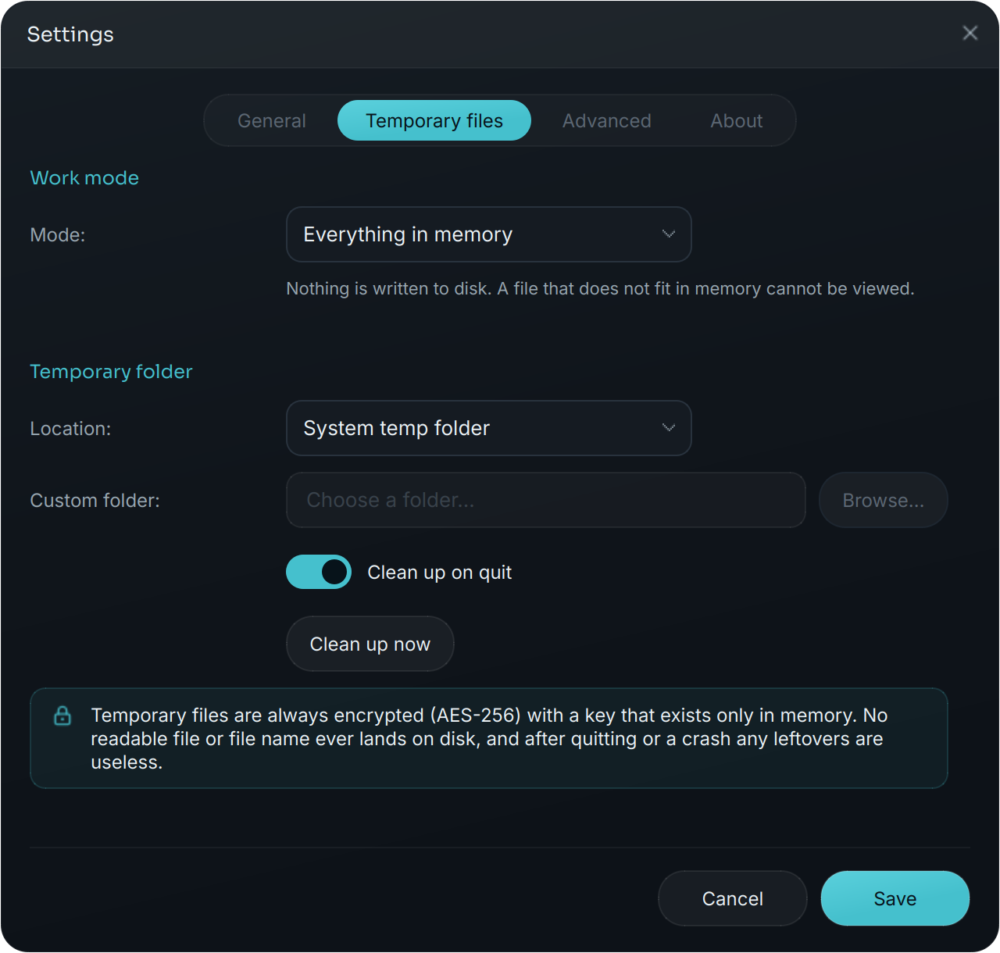

# Archy manual

Everything Archy can do, and how. For installing and starting Archy, see
[Getting started](README.md#getting-started) in the README; for what changed
per version, see [CHANGELOG.md](CHANGELOG.md).

- [Opening archives](#opening-archives)
- [Browsing](#browsing)
- [Previews](#previews)
- [Extracting](#extracting)
- [Editing archives](#editing-archives)
- [Privacy and temporary files](#privacy-and-temporary-files)
- [Memory and settings](#memory-and-settings)
- [Languages](#languages)
- [Keyboard shortcuts](#keyboard-shortcuts)
- [Tips for large 7z backups](#tips-for-large-7z-backups)
- [Rar and other formats](#rar-and-other-formats)
- [For developers](#for-developers)
- [Roadmap](#roadmap)
- [Built with](#built-with)

## Opening archives

Open an archive with **Ctrl+O**, by dropping it on the empty window, from the command
line (`archy ~/Backups/photos.7z`), with "Open with" on Windows and Linux, or by
dropping it on the Dock icon on macOS.

Archy reads:

- **zip**, including ZipCrypto and WinZip AES encryption
- **7z**, including AES-256 with encrypted file names
- **tar**, tar.gz, tar.bz2 and tar.xz
- **rar**, iso, cpio, cab, xar and ar when libarchive is installed (see
  [Rar and other formats](#rar-and-other-formats))

For an encrypted archive Archy asks for the password once and keeps it in
memory only; it is never stored. The index of an archive is read in the
background while a spinner shows, so even a 100,000-file encrypted 7z opens
without freezing the window.

## Browsing

Walk the folders of an archive like a normal folder. Four views: **list**,
**compact**, **thumbnails** and **large thumbnails**. In the thumbnail views
the tiles grow with the width of the list until another column fits, so a
row is always filled. Besides photos and videos, documents get a thumbnail
too: the top of a PDF's first page, a web page or Markdown file as a small
page, the first lines of a text or code file, and for Office files the picture
Office saved with them or a small page of their text. A file Archy cannot preview
keeps a dimmed icon, so you see at a glance what opens in the preview. The sidebar filters the archive by type: images,
videos, documents and other files.

- **Search the whole archive** by name or path with **Ctrl+Shift+F**; the
  results show where each file lives. Double-click one to go there.
- **Filter the current folder** with **Ctrl+F**.
- **Back and forward** through the folders you visited with the arrows at the
  start of the path, the mouse's back and forward buttons, or **Alt+Left** /
  **Alt+Right** (**Cmd+[** / **Cmd+]** on macOS).
- **Find the selection again:** after scrolling away in a long folder, the
  round button with the target, at the far left above the list, scrolls the
  selected file back into the middle of the view.
- **Keeps your place:** going back up (with the path, Back or Up) selects the
  folder you came out of and scrolls to it, so a long folder does not start at
  the top again. Coming back into a folder puts the cursor on the file you were
  at.
- **Jump to a folder next to this one:** click a **/** in the path to see the
  folders at that level (20 at a time); type to narrow the list down, use the
  arrow keys and Enter, or click one.
- **Sort** by name, type, size or date modified, ascending or descending, with
  the sort button next to the views (in the list view also by clicking a
  column header). Folders always come first, in search results too. Archy
  remembers the sort for next time.
- **Sort by a timestamp in the name:** for files whose name starts with a Unix
  time, such as `1696512000--beach.jpg`, `1696512000-beach.jpg` or
  `1696512000123_IMG_0042.jpg` (seconds or milliseconds, followed by `-`,
  `--`, `_` or the extension), choose *Timestamp in name* in the sort menu.
  Those files come first, oldest to newest (or the other way round), and the
  files without one follow by name. In a folder with such names the list view
  shows the time as a date in its own column, and pointing at a name shows it
  in every view.

**Archives inside an archive** (experimental): double-click a zip, 7z or tar
(also .tar.gz) inside the archive to open it like a folder. It is read from
memory and opens read-only; you can browse, preview, search and extract. The
path shows the way back (and a *Test* label while this is being tested), and
Backspace at its top goes back to where you were. Close closes all of them.

When you open a folder in a thumbnail view (or the first file in it), Archy
reads the whole folder in one pass in the background and makes every
thumbnail along the way, with a progress indicator. After that the folder
browses instantly.

## Previews

Select a file to preview it. Everything is read into memory and shown from
there; nothing is unpacked to your disk.

Under the file name you see what is useful to know about that file: for a
photo its size in pixels, the camera, lens settings and when it was taken; for
a video its length, resolution and frame rate; for a PDF the number of pages,
title and author; for a text file the number of lines and the encoding. The
type and size are at the bottom of the pane. The info button (ⓘ) lists all of
it, including the lens.

**Photos and images.** JPEG, PNG, WebP, HEIC (iPhone photos), AVIF, TIFF, GIF,
BMP, ICO and SVG. Photos are always shown upright, following the camera's
orientation. Zoom with the wheel or the buttons under the image, rotate, and
use the arrows for the previous and next file. **F11** shows the preview full
screen, where the arrow keys go to the previous and next file.

**Camera RAW and Photoshop.** RAW files from Canon (CR2, CR3), Nikon (NEF),
Sony (ARW), Fujifilm (RAF), Olympus (ORF), Panasonic (RW2), Pentax (PEF) and
DNG show the preview the camera stores inside the file, often at full or half
resolution, upright, with the camera details. Photoshop files (PSD) show their
flattened image, as saved with "Maximize compatibility" (Photoshop's default),
or else their thumbnail.

**Slideshow.** **F5** or the play button under a photo shows the photos of the
folder one after another, full screen. It skips files that are not photos,
photos too large for memory and photos that cannot be decoded. Move the mouse
for a bar with previous, play/pause, next, the time per photo (minus and plus)
and stop; after 2.5 seconds without moving, the bar and the mouse pointer hide
again. **Space** pauses and continues, the arrow keys go back and forward,
**Esc** stops. The time per photo you choose is remembered (also under
*Settings > General*).

**Video.** Play and pause with **Space**, jump 10 seconds back or forward, drag
the seek bar or click on it, and step frame by frame with the scroll wheel
while paused. In a 7z made with *Store* a video starts at once and is read
while it plays, however large it is. Thumbnails of portrait phone videos stand
upright.

**Music.** MP3, FLAC, WAV, M4A/AAC, Ogg, Opus, WMA and AIFF play in the
preview with the same controls as a video, showing the cover art, title and
artist when the file has them.

**PDF.** Scroll through the pages and zoom.

**Word, Excel and PowerPoint.** A Word document (.docx) shows as a page with
its headings, lists, tables and pictures; a PowerPoint deck (.pptx) as one card
per slide with its text and pictures where they are on the slide; an Excel
workbook (.xlsx) as a table per sheet, with the values as Excel last
calculated them (the first 5,000 rows and 200 columns). These are previews:
layout and fonts come close to Office, not exactly. Macros are never run, and
nothing the document refers to outside the archive is loaded. The older formats
(.doc, .xls, .ppt) and documents protected with a password in Office itself
have no preview.

**Text and code.** The encoding is detected automatically (UTF-8, UTF-16,
older Windows code pages) and emoji show in colour. Some formats get more:

<p align="center">
  
</p>


| Format | What you see |
| --- | --- |
| JSON, YAML, TOML, XML | Syntax colours: keys, text, numbers, true/false/null and comments each in their own colour |
| CSV, TSV | A table, with every column in its own colour; switch to **Source** for the text, where every column keeps its colour ("rainbow CSV"). The delimiter (comma, semicolon, tab or `\|`) is detected automatically |
| HTML | The page the way a browser shows it; switch to **Source** for the HTML |
| Markdown | The formatted text; switch to **Source** for the Markdown |

The switch you choose is remembered for the rest of the session. A rendered
HTML or Markdown file uses the stylesheets, images and fonts it refers to when
they are in the same archive. Web pages are drawn by Chromium (QtWebEngine), so
all of CSS works: flexbox, grid, gradients, variables and web fonts. Nothing
from outside the archive is ever loaded: no images or fonts from the internet,
no scripts, and links do not open. The page is kept in memory only, like every
other preview (no browser cache or cookies on disk). Where QtWebEngine is not
available, Qt's own renderer is used; it handles common styling (colours,
fonts, margins, borders, tables), but not modern layout such as flexbox or
grid.

**Find in a file.** Click in a text preview and press **Ctrl+F** (Cmd+F on
macOS). Every match is highlighted; **Enter** and **Shift+Enter** go to the next
and previous match, **Esc** closes the find bar. This works in the source, in
rendered pages and in CSV tables.

## Extracting

Extract the selection with **Ctrl+E**, or everything with **Ctrl+Shift+E**, or
drag files out of Archy to where you want them. A progress window shows the
file being written, a progress bar, the speed and the time left; you can cancel
or let it continue in the background. Every file is checked against its
checksum while it is written.

## Editing archives

zip and 7z archives can be changed:

- add files and folders (**Ctrl+Shift+A**, or drag them onto the window)
- create a folder (**Ctrl+Shift+N**)
- rename (**F2**) and delete (**Delete**)
- edit small text files in a zip directly in the preview

Changes are collected first and written when you press **Save** (**Ctrl+S**).
Archy then writes a complete new version next to the original, checks it, and
only then puts it in place of the original, so a failed or cancelled save never
damages your archive. A 7z keeps its password, encrypted file names, Store or
compression, separate blocks and file times. In a zip, the files you did not
change are copied as they are, so a save takes about as long as copying the
archive. Rar and the other libarchive formats are read-only.

**The edit lock.** Archives that Archy only reads show a lock next to their
name; its tooltip says why. Encrypted archives start locked, so nothing changes
by accident. An encrypted zip, and an encrypted 7z made with *Store*, can be
unlocked on purpose with one click; a dialog first explains what saving will
do. In an encrypted zip the files you did not change stay exactly as they were
(ZipCrypto or AES); new and changed files are encrypted with AES-256 and the
same password. Note that the zip tools built into Windows and macOS cannot open
AES-encrypted files; 7-Zip, WinZip and Archy can. An encrypted, compressed 7z
stays locked, because saving it would mean compressing everything again.

## Privacy and temporary files

Archy only writes to disk when you ask it to: when you extract, and when you
save an edited archive. Everything else stays in memory.

Some archives are simply bigger than your memory. For those, *Settings >
Temporary files* has three work modes:

| Mode | What it does |
| --- | --- |
| **Everything in memory** (default) | Nothing is written. A file that does not fit in memory cannot be previewed. |
| **To disk when memory is tight** | Memory first. What does not fit (a huge folder, a large video or PDF) goes to the temp folder. |
| **Always use temporary files** | The open folder is unpacked to the temp folder instead of memory, and videos and PDFs play from there. Lowest memory use, a bit slower. |

Temp files are **always encrypted** with AES-256. The key is random, exists
only in Archy's memory and changes every session. Files get random names
without extensions, so the temp folder reveals nothing except sizes. Archy
cleans up when it closes (or when you press *Clean up now*). If it ever crashes,
what it leaves behind is unreadable without the lost key, and it is removed the
next time Archy cleans up.

<p align="center">
  
</p>

## Memory and settings

Archy keeps to a memory budget of its own: a share of your RAM, with a reserve
always left free for the rest of the system. Under *Settings > Advanced* you
can set the limit and every buffer (the open folder, the thumbnail cache, the
read cache, video) to automatic or a fixed size, and choose how many threads
make thumbnails.

Open the settings with the gear in the top bar or **Ctrl+,**:

- **General:** language, start view, preview fit, compact rows, accent colours,
  and whether to remember the window size and position.
- **Temporary files:** the work mode, the location and cleaning up.
- **Advanced:** memory limits and threads.
- **About:** the version, who makes Archy, its license, and the open source
  software it is built on with their licenses.

A notice tells you when a change only applies after reopening the archive or
restarting Archy.

## Languages

Archy speaks English and Dutch and follows your system language by default; a
different one can be chosen under *Settings > General*. Adding a language takes
one JSON file and no rebuild; see [TRANSLATING.md](TRANSLATING.md). Plural forms
for languages such as Polish and Russian are supported.

## Keyboard shortcuts

On macOS, read Cmd for Ctrl.

| Action | Shortcut |
| --- | --- |
| Open an archive | Ctrl+O |
| Close the archive | Ctrl+W |
| Search the whole archive | Ctrl+Shift+F |
| Filter the current folder | Ctrl+F |
| Find in the previewed text file (click in the preview first) | Ctrl+F |
| Go up one folder | Backspace |
| Back / forward | Alt+Left / Alt+Right (Cmd+[ / Cmd+] on macOS), mouse buttons |
| Extract selection / everything | Ctrl+E / Ctrl+Shift+E |
| Add files / new folder | Ctrl+Shift+A / Ctrl+Shift+N |
| Rename / delete | F2 / Delete |
| Copy the path inside the archive | Ctrl+Shift+C |
| Save changes | Ctrl+S |
| Full screen preview | F11 |
| Slideshow of the folder's photos (Space pauses) | F5 |
| Play or pause a video | Space |
| Step one frame (paused video) | Scroll wheel |
| Settings | Ctrl+, |

## Tips for large 7z backups

How a 7z was created matters a lot for browsing speed. In a *solid* archive,
many files are compressed together as one block, so reading one file means
decompressing everything before it in that block. Archy softens this for
archives as they are, without repacking:

- It reads a whole folder in one pass.
- When the archive was made by 7-Zip with several threads (the default on a
  modern computer), the block has points where decoding can start fresh. Archy
  finds them and starts at the nearest one before the folder, instead of at the
  start of the block.
- It keeps its place in a block after a folder, so moving on to the next folder
  continues from there.

Even so, the first folder deep inside a large block of an older or
single-threaded archive still takes a while.

For a backup you want to browse, choose in 7-Zip:

- **Compression level:** *Store* for media that is already compressed (JPEG,
  RAW, video). It is hardly any bigger, and Archy reads every file in it
  directly: photos open at once, and videos start playing right away, even when
  they are larger than your memory. With Store, 7-Zip keeps every file in its
  own block by itself.
- **Encryption:** AES-256 with *Encrypt file names* checked.

Adding files to such a backup later: use *Add to archive* and set these options
again in the dialog. Dragging files onto an open archive in the 7-Zip window
uses 7-Zip's default settings (compressed, solid) without asking, which makes
those new files slow to read. Archy notices such a *mixed archive*: a notice
above the file list says how many files are in compressed blocks. Recreate the
archive with Store (or add the files again with Store) and every file opens
quickly again.

A backup made this way can also be edited in Archy: click the lock next to its
name to unlock it. Saving rewrites the archive next to the original (it needs
as much free space as the archive, for a moment) and replaces the original only
after checking the new version. Archives with more than 65,536 files are fully
supported.

## Rar and other formats

zip, 7z and tar work out of the box on every platform. For rar, iso, cpio, cab,
xar and ar, install the native libarchive library:

| Platform | Command |
| --- | --- |
| macOS | `brew install libarchive` |
| Debian / Ubuntu | `sudo apt install libarchive13` |
| Fedora | `sudo dnf install libarchive` |
| Windows | Optional: place `libarchive.dll` next to the app |

`python scripts/check_libarchive.py` tells you whether Archy can find it.
Optionally, `pip install -e ".[video-fallback]"` adds PyAV, which Archy then
also uses for video thumbnails.

## For developers

```bash
pip install -e ".[dev]"
pytest                                  # the full test suite
QT_QPA_PLATFORM=offscreen pytest        # the same, without a display
ruff check . && ruff format --check .   # lint and formatting
archy --self-test                       # check an installation, no window
```

The code is organised in three layers:

```
src/archy/
  core/       archive model, format detection and backends (no Qt)
  services/   preview providers, encrypted temp files, formatting helpers
  ui/         PySide6 windows and widgets
    main_window/  the main window, split into one mixin per concern
    theme/        the "Soft Depth" theme: palette, icons, stylesheet, fonts
packaging/    PyInstaller spec plus the Windows, macOS and Linux installers
scripts/      developer tools, including the README screenshot generator
tests/        pytest suite (headless core tests plus offscreen UI tests)
```

New to the code? Start with [ARCHITECTURE.md](ARCHITECTURE.md). It explains the
layers, the in-memory rule, the backend contract, the memory policy and the
threading model. [packaging/README.md](packaging/README.md) describes how the
installers are built.

Contributions are welcome. Please keep `archy.core` free of Qt, add a test for
behaviour you change, add a line to [CHANGELOG.md](CHANGELOG.md) for anything a
user would notice, and make sure `pytest` and `ruff` pass before opening a merge
request. Code, comments and docs are in English; UI texts go through `tr()` and
the JSON catalogs (see [TRANSLATING.md](TRANSLATING.md)). Translations to new
languages are very welcome.

## Roadmap

- **Next:** installers for Windows (Inno Setup), macOS (.dmg) and Linux
  (AppImage), built in CI.
- More interface languages (German, Polish, Russian, ...): contributions welcome.
- Rar support on Windows without a separate libarchive install.
- Sort by date taken, rating and camera.
- Office documents: previews for doc, docx, xls and xlsx.

## Built with

[PySide6 / Qt 6](https://doc.qt.io/qtforpython-6/),
[py7zr](https://github.com/miurahr/py7zr),
[pyzipper](https://github.com/danifus/pyzipper),
[libarchive-c](https://github.com/Changaco/python-libarchive-c),
[pycryptodomex](https://www.pycryptodome.org),
[psutil](https://github.com/giampaolo/psutil),
[charset-normalizer](https://github.com/jawah/charset_normalizer) and
[pi-heif](https://github.com/bigcat88/pillow_heif) with
[Pillow](https://python-pillow.org).
The interface uses the Inter, Sora and JetBrains Mono fonts (SIL Open Font
License).
